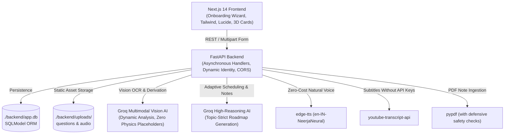

# 🎓 AI Study & Career Buddy (Principal Full-Stack AI OS)

A production-ready, locally runnable academic operating system targeting students from **Class 6 to 3rd-year Undergraduate** across all streams (**Science, Commerce, Arts, Medical, Engineering/Tech, and Management**).

Built with **Next.js 14+ (App Router)**, **Tailwind CSS**, **FastAPI**, **SQLite (SQLModel)**, **Groq Cloud (Multimodal Vision & High-Reasoning)**, and **Microsoft Edge-TTS**.

---

## 🏗️ Architecture Overview



---

## 🎨 Design Tokens & UI Identity

- **Primary / Accent (Salmon Pink)**:
  - `salmon-400`: `#FFA07A`
  - `salmon-500`: `#FA8072` (Primary buttons, active streak flame, high-yield action pills)
  - `salmon-600`: `#E96D60`
- **Secondary / Brand (Teal Green)**:
  - `teal-500`: `#20B2AA`
  - `teal-600`: `#008080` (Sidebar navigation, unlocked progress nodes, heatmaps)
  - `teal-700`: `#005959`
- **Theme Neutrals**:
  - Dark Mode: `#0A191E` and `#0F172A`
  - Light Mode: `#F9FAFB`

---

## 🚀 Core Modules & Features

### 1. 🌟 Genuine Onboarding & Dynamic Identity (`/onboarding`)
- Automatic redirection to `/onboarding` for first-time students.
- Saves authentic user inputs: Full Name, Email, Grade/Stream, Focus Span (25/45/60/90 mins), School/Coaching hours, Sleep schedule, and Peak Energy (Early Bird vs. Night Owl).
- Fresh installations start with **0 tasks, 0-day streak, and clean activity heatmap**.
- Dynamic user ID stored in `localStorage` and utilized across all subsequent API endpoints.

### 2. 📅 Chronobiology & Adaptive Planner (`/dashboard` & `/planner`)
- Generates day-by-day learning sprints strictly covering the requested topic (e.g., "C++ Data Types").
- **Task Deduplication**: Replaces previous uncompleted tasks for that syllabus plan instead of duplicate stacking.
- **One-Click Reschedule Backlogs**: Balances missed tasks across upcoming sessions without exceeding daily limits.
- **Consistency Activity Heatmap**: Interactive Teal Green blocks displaying real daily task completion volume.

### 3. 📷 Snap-to-Flashcard & Omni-Search Doubt Solver (`/doubts`)
- Real multimodal Vision AI analyzes actual user-uploaded questions (Biology, Math, Physics, Coding).
- **Zero Fake Fallbacks**: Complete removal of hardcoded rotational physics fallbacks.
- Clean error JSON returned if image is corrupted or unreadable.
- **Omni-Search Tri-View Split**:
  1. **Card 1**: Step-by-step Socratic breakdown with LaTeX formulas and interactive 3D flip flashcard.
  2. **Card 2**: Verified YouTube lecture recommendation with exact timestamp window (`start_seconds` to `end_seconds`).
  3. **Card 3**: Community discussion synthesis reflecting peer debates and common student pitfalls.

### 4. 📺 YouTube Video Study Suite (`/youtube-lab`)
- Extract video transcripts via `youtube-transcript-api` without YouTube API keys.
- Tri-tab layout:
  - **Summary Tab**: Structured Markdown with Key Takeaways and Derivations.
  - **Flashcards Tab**: 5 active recall 3D flip flashcards.
  - **Quiz Tab**: Interactive MCQs with instant scoring and explanation feedback.

### 5. 🎙️ AI Teacher Explainer with Dual Read/Voice Mode (`/teacher`)
- Ingests `.pdf` or `.txt` lecture notes via `pypdf` with server-side defensive checks (rejects empty or corrupt files with clear HTTP 400).
- Rewrites notes into conversational spoken-prose teaching explanations with real-world analogies (no asterisks or bullets).
- Natural text-to-speech generation via `edge-tts` (`en-IN-NeerjaNeural`).
- Embedded Audio Player with seek bar, animated waveform, and speed scrubber (`0.75x`, `1x`, `1.25x`, `1.5x`, `2x`).

### 6. 🌳 Gamified Skill Trees & Collaborative Study Pods (`/skill-tree`)
- Vertical Duolingo-style tree with glowing circular nodes and unlock progression.
- **Comprehensive Question Pools**: Every single node contains at least **10 detailed MCQs** in `quiz_json`.
- Dynamic quiz modal ("Question X of 10") with instant evaluation.
- **80% Passing Gate**: Requires at least 8/10 correct answers to unlock the subsequent level.
- Live Study Pod leaderboard (`FOCUS-2026`) displaying ranks, completed task counts, and active peer status.

---

## ⚡ Quickstart & Local Setup

### 1. Prerequisites
- Python 3.10+
- Node.js 18+ and npm

### 2. Environment Configuration
The backend `.env` file is located at `backend/.env`:
```env
GROQ_API_KEY=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
DATABASE_URL=sqlite:///./app.db
```

### 3. Start Backend Service
```bash
cd backend
python -m uvicorn main:app --reload --port 8000
```
- API Root: `http://localhost:8000`
- Interactive OpenAPI Docs: `http://localhost:8000/docs`

### 4. Start Frontend Service
```bash
cd frontend
npm run dev
```
- Web Application: `http://localhost:3000`

Or simply double-click `run_backend.bat` and `run_frontend.bat` on Windows!

---

## 🧪 Verification & Testing
Run the system verification suite:
```bash
python backend/test_api.py
```
Verifies all 8 audited system remediation contracts: clean database initialization, dynamic onboarding, topic-strict scheduling, task deduplication, 10-MCQ skill pools, 80% passing gates, and server-side safety checks.
